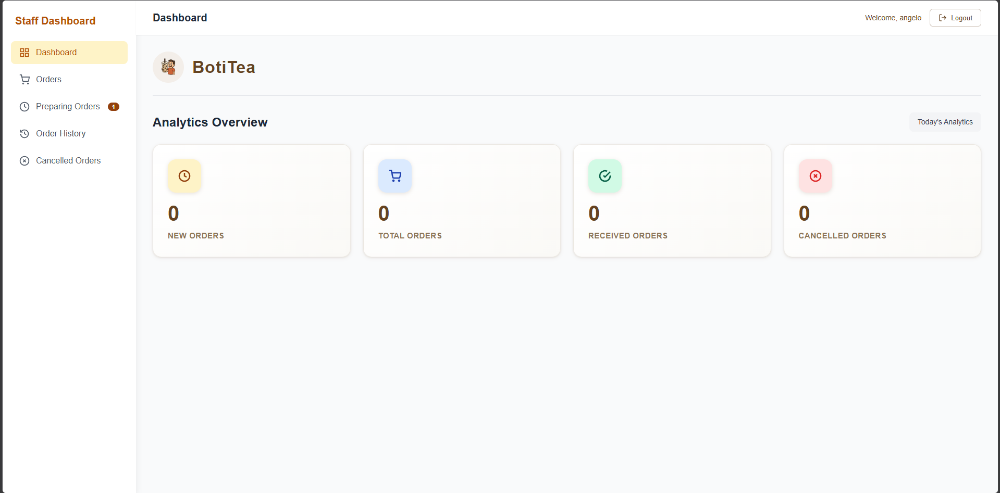
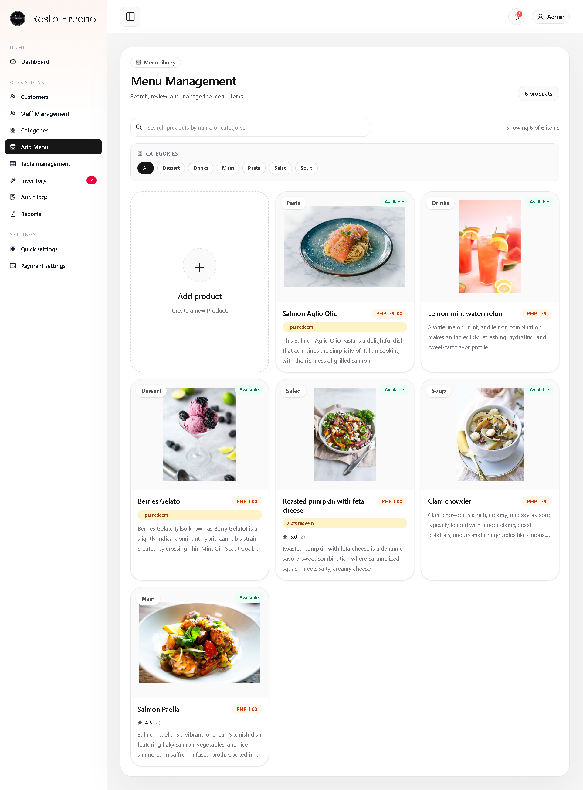
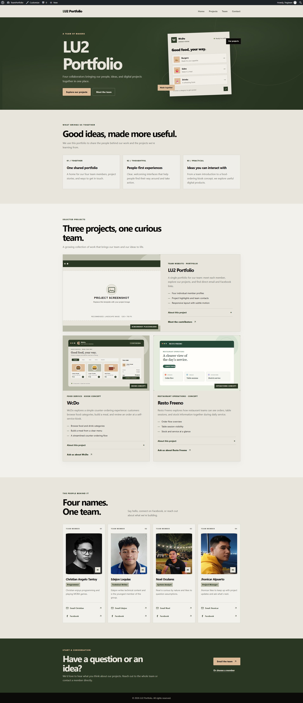
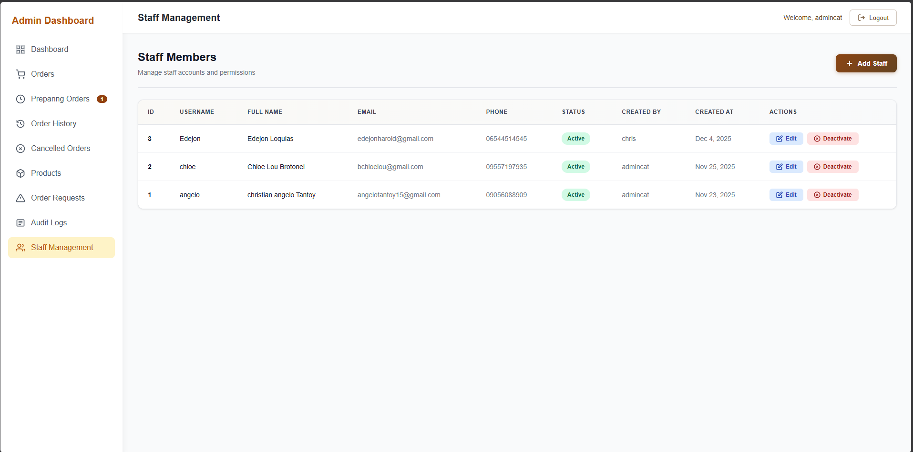
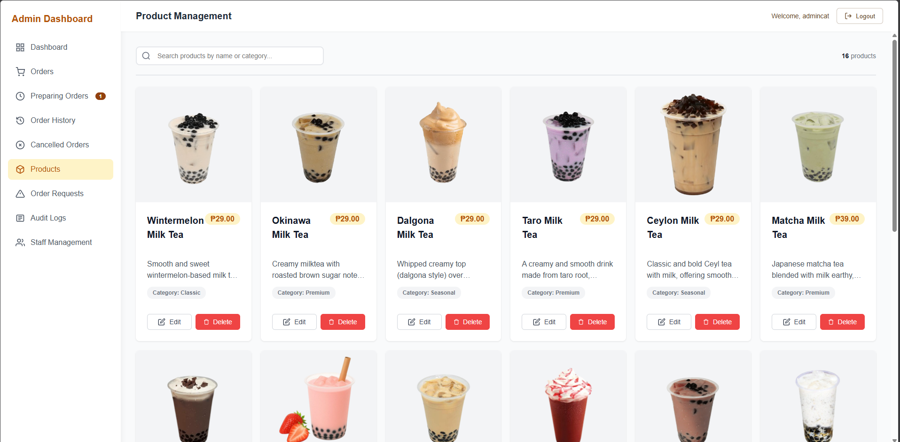
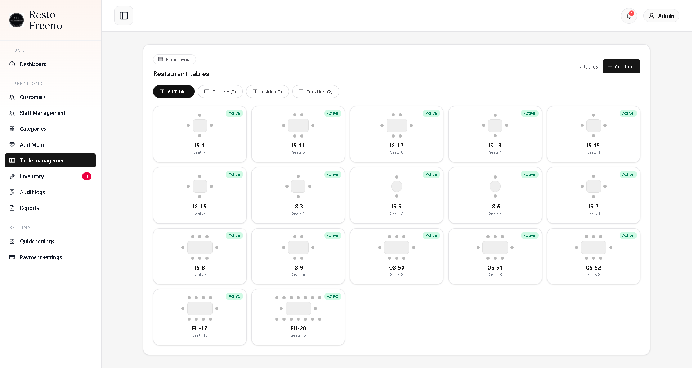
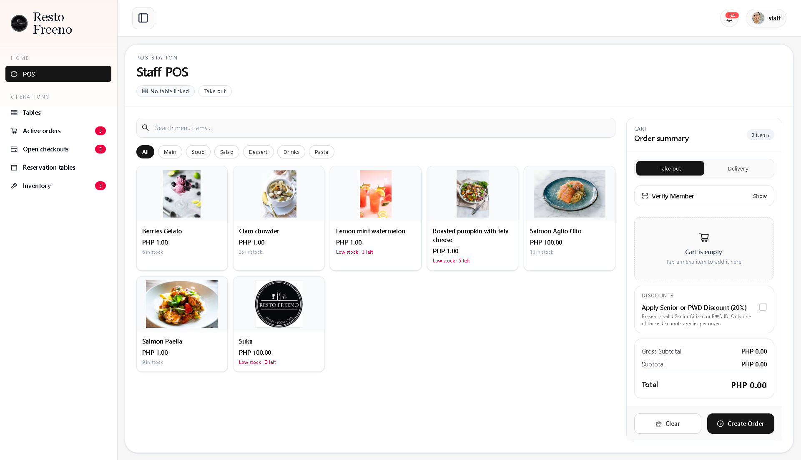

<div align="center">

# LU2 Portfolio

### One team. Three projects. A shared place to explore our work.

**A custom WordPress portfolio for the LU2 team — built to introduce the people, showcase the projects, and make it easy to connect.**

<p>
  
  
  
  
</p>

<p><a href="#projects">Explore projects</a> · <a href="#team">Meet the team</a> · <a href="#getting-started">Run it locally</a></p>

</div>

---

## ✨ About the project

LU2 Portfolio is a responsive team website built as a custom WordPress theme. It brings together four member profiles, project highlights, contact links, and small interactive details in one warm, forest-inspired design.

### At a glance

| 👥 People | 🧩 Projects | 🎨 Theme | ✨ Interaction |
|:--|:--|:--|:--|
| Four member profiles with portraits and resumes | LU2 Portfolio, BotiTea, and Resto Freeno | Ink, forest green, sage, warm off-white, and sand | Project carousel, expandable details, mini-games, and motion effects |

## 🖼️ Project previews

<table>
  <tr>
    <td align="center" width="50%">
      <strong>🧋 BotiTea</strong><br>
      A drinks shop management system for orders, products, and staff.<br><br>
      
    </td>
    <td align="center" width="50%">
      <strong>🍽️ Resto Freeno</strong><br>
      Restaurant operations for orders, tables, and stock.<br><br>
      
    </td>
  </tr>
</table>

<details>
  <summary>View the LU2 Portfolio page preview</summary>
  <br>
  
</details>

## 🧩 Project details

### 🌿 LU2 Portfolio — team website

The portfolio is the shared home for the four-person LU2 team. It introduces each contributor, explains the work, and gives visitors a direct way to get in touch. The site is a custom WordPress theme with responsive layouts, project snapshots, profile spotlights, resume image viewing, and a small interactive games area.

**Purpose:** Present the team and its projects in one easy-to-explore place.  
**For:** Visitors, classmates, and collaborators who want to learn about the team or its work.

### 🧋 BotiTea — drinks shop management

BotiTea is a focused system concept for a milk tea and drinks shop. It brings common shop tasks together, including tracking incoming orders, managing drink products, and maintaining staff accounts. Its scope stays centered on beverage shop operations.

**Audience:** Shop staff and administrators.  
**Key areas:** Order tracking (new, received, and cancelled), drink catalog management, and staff tools.

<details>
  <summary>Browse BotiTea screenshots</summary>
  <br>
  
  
  
</details>

### 🍽️ Resto Freeno — restaurant operations

Resto Freeno explores a wider view of daily restaurant service. The concept brings order flow, table sessions, and stock information together so a restaurant team can keep track of service from one place. It covers broader restaurant operations than BotiTea’s drinks-focused scope.

**Audience:** Restaurant teams coordinating daily service.  
**Key areas:** Order flow, table session visibility, and stock information.

<details>
  <summary>Browse Resto Freeno screenshots</summary>
  <br>
  
  
  
</details>

## 🚀 What you can explore

- **Meet the team:** Four profiles with portraits, roles, biographies, and direct contact links.
- **View resumes:** Open each member’s resume JPEG in an animated image viewer.
- **Explore projects:** Browse screenshots and expandable summaries for the portfolio, BotiTea, and Resto Freeno.
- **Play a little:** Try the interactive games section and its portrait puzzles.
- **Enjoy thoughtful motion:** Scroll reveals and interface transitions add movement while reduced-motion preferences are respected.
- **Use it on any screen:** Responsive layouts adapt the portfolio for desktop, tablet, and mobile.

## 👋 The team

| Member | Role | Contact |
|:--|:--|:--|
| **Christian Angelo Tantoy** | Programmer | [Email](mailto:occ.tantoy.christianangelo@gmail.com) · [Facebook](https://www.facebook.com/profile.php?id=100079167701761) |
| **Edejon Loquias** | Technical Writer | [Email](mailto:occ.loquias.edejon2004@gmail.com) · [Facebook](https://www.facebook.com/share/1CbzuKs8p6/) |
| **Noel Oculares** | System Analyst | [Email](mailto:occ.oculares.noel@gmail.com) · [Facebook](https://www.facebook.com/share/1CDjB4vEft/) |
| **Jhonicar Alpuerto** | Project Manager | [Email](mailto:occ.alpuerto.jhonicar@gmail.com) · [Facebook](https://www.facebook.com/jhonicar.alpuerto.5) |

## 🧰 Built with

| Technology | How it is used |
|:--|:--|
| **WordPress** | CMS and theme runtime |
| **PHP** | Theme templates, setup, and WordPress hooks |
| **HTML** | Page structure and accessible content |
| **CSS** | Layout, responsive styling, theme, and keyframe animations |
| **JavaScript** | Carousel, games, resume viewer, and interactive behavior |

## 🗂️ Project structure

```text
lu2-TeamPortfolio/
├── wp-admin/                         # WordPress administration
├── wp-content/
│   ├── plugins/                      # Installed WordPress plugins
│   └── themes/
│       └── teamportfolio/            # Custom LU2 portfolio theme
│           ├── assets/
│           │   ├── audio/            # Theme sound effects
│           │   └── image/
│           │       ├── TeamPhoto.png    # Team section background
│           │       ├── ProjectsImages/  # Project screenshots and logos
│           │       └── Resume/          # Team resume JPEGs
│           ├── css/
│           │   ├── style.css         # Main styles and components
│           │   └── homesection.css   # Homepage and seasonal effects
│           ├── js/
│           │   └── motion.js         # Motion and interactive features
│           ├── front-page.php        # Portfolio homepage
│           ├── functions.php         # Theme setup and asset loading
│           ├── header.php            # Site header and navigation
│           ├── footer.php            # Site footer
│           ├── index.php             # WordPress fallback template
│           └── style.css             # WordPress theme information
├── wp-includes/                      # WordPress core libraries
├── wp-config.php                     # Local WordPress configuration
└── README.md
```

## 🛠️ Getting started

This repository contains a WordPress site. Start it with a local WordPress environment such as Laragon, then:

1. Place the project in your local web root and create a MySQL database for the site.
2. Set the database name, username, and password in `wp-config.php` for your local setup.
3. Start the web server and database, then open the site through your local WordPress URL.
4. In WordPress Admin, open **Appearance → Themes** and activate **LU2 Portfolio**.
5. Optionally assign a **Primary Menu** under **Appearance → Menus**. The theme provides section links when no menu is assigned.

To install only the theme in an existing WordPress site, copy `wp-content/themes/teamportfolio/` into that site's `wp-content/themes/` directory and activate it from the dashboard.

## 🎨 Design notes

The interface uses a quiet, earthy palette with clear contrast and small moments of motion.

| Color | Hex |
|:--|:--|
| Ink | `#0c0a08` |
| Forest green | `#2a3723` |
| Sage | `#b9bba8` |
| Warm off-white | `#e8e5dd` |
| Sand | `#dcbc98` |

Motion is reduced for visitors whose device requests reduced motion. The resume viewer, menus, and interactive controls are designed to work with keyboard input as well.

## 📌 Project context

Created as a team portfolio project for the **Bachelor of Science in Information Technology (BSIT)** program. The site presents the team's work and documents the projects in a single responsive experience.

---

<div align="center">

**Made by the LU2 team** · Thanks for stopping by 👋

</div>
